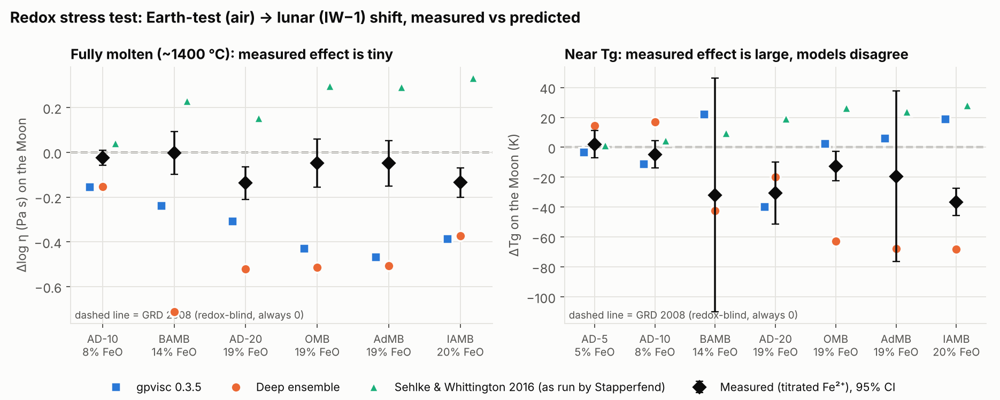
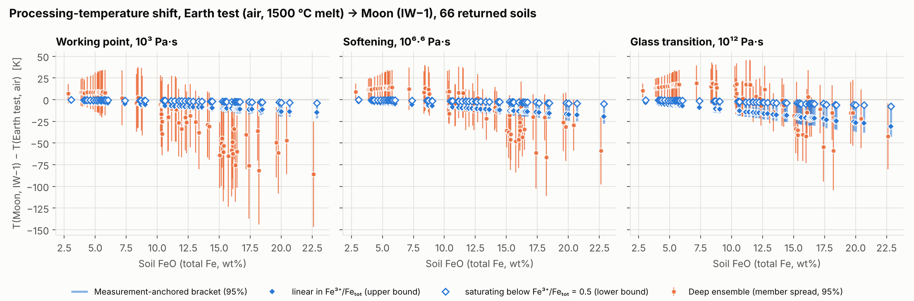

# Results: lunar regolith melt viscosity, Earth tests vs Moon conditions

Status: steps 1–4 and deliverables 1–3 done (first full pass). Stretch goal not started.
Every number below comes from `results/tables/`; figures are in `results/figures/`.

## The answer in four lines

1. **Fully molten (MRE, melt extrusion):** measured redox effect is small. Going from
   Earth-test iron (Fe³⁺/Feₜₒₜ ≈ 0.6) to lunar iron (≈ 0.02) lowers viscosity by
   ≤ 0.14 log units, or a working-point shift of about −1 to −16 K. Air data is usable here.
2. **Near Tg (sintering):** the shift is several times larger in K and scales with iron.
   Mare soils (FeO ≈ 17 wt%): Tg is 5–22 K lower on the Moon than in a 1500 °C air-melted
   test, and 15–32 K lower than in an air-sintered (~1100 °C) test. At a fixed sintering
   temperature that is up to ~1.4 orders of magnitude lower viscosity. Highland soils: 1–11 K.
3. **No current model gets the redox direction right reliably.** Every ML model,
   gpvisc included, overstates the high-temperature redox effect 3–10×. Near Tg they
   disagree in sign. gpvisc has the sign wrong in 5 of 7 measured series, though it
   was trained on those studies. Sehlke & Whittington, as Stapperfend ran it, predicts
   the *opposite* direction (reduction raises viscosity and Tg) in 12 of 13 series, an
   artefact of how its spreadsheet handles Fe₂O₃. In the paper's own convention it is redox-blind.
4. **The biggest unknown is not the models; it is missing data.** In every source I found,
   no basaltic melt has measured viscosity or Tg below Fe³⁺/Feₜₒₜ ≈ 0.12. Whether Tg keeps falling there
   (linear) or levels off (as Chevrel's synthetic AD melts do below 0.5) is worth a
   factor of ~4 in the predicted shift. The ensemble's ranking independently points
   to exactly that gap.

## Corrections to the project brief

| Brief said | What the data shows |
|---|---|
| "about 60% Fe³⁺ in the Stapperfend simulants" | Correct number, but it is *calculated* (Kress & Carmichael 1991 at air, 1500 °C), not measured. I reproduced it to ±0.01. An air-*sintered* test at ~1100 °C would sit near 0.9. |
| "only 50 [gpvisc rows] have lunar-like reduced iron, all from one 1995 study" | In the `lp` sheet, 375 rows (113 compositions, 10 studies) have FeOₜ ≥ 5 wt% and Fe³⁺/Feₜₒₜ < 0.1. Ducret 1995 is the largest (236). Same conclusion, stronger form: only one composition (a Liebske 2003 andesite) has reduced iron near Tg. |
| "Sehlke & Whittington is redox-aware (Stapperfend fed it KC1991 Fe³⁺)" | The paper treats all iron as FeO* in Be, Sconf and Cp, so it is redox-blind. Stapperfend's numbers reproduce only under a different convention (Fe₂O₃ dilutes the mol% but only FeO enters the terms), and in that convention the redox response has the wrong sign. |
| "redox test: Chevrel 2013, Di Genova 2017, Cukierman & Uhlmann 1974" | gpvisc's Chevrel 2013 rows are air measurements with *calculated* Fe³⁺ that changes with T, not a redox series. The real controlled-fO₂ data with titrated Fe²⁺ is in Chevrel's open-access PhD thesis. Di Genova 2017A in gpvisc has only 8 high-T points. Cukierman & Uhlmann 1974 is paywalled and not yet included. |
| 28,868 measurements | That is `dataset+sciglass_lp.csv` + `hp`. The `lp` sheet in `database.xlsx` has 15,440 rows (13,981 anhydrous) and is what I trained on, as the brief specified. |
| (Stapperfend AmMin Table 4) | Misprinted Vogel temperatures for LRV-6 and LRV-7/8. The printed A, B, C miss the paper's own data by 0.7–1.1 log units; refits reproduce the printed Tg to within 1 K. |

Also worth saying in an interview: the simulants differ from lunar soils in more than redox.
They carry 2–4 wt% Na₂O against 0.3–0.5 in real soils.

## Step 2: pipeline validation (reproduce Stapperfend)

Against both papers' tables for all 16 simulants (`results/tables/reproduction_check.csv`):

- Redox convention reproduced: KC1991 at air and 1500 °C gives their printed Fe³⁺/Feₜₒₜ to ±0.01.
- GRD 2008 VFT parameters within 9 K (B) and 1.3 K (C).
- Superliquidus RMSE for GRD and gpvisc within a median 0.002 log units of published values.
- Δη(Tg) within 0.08 log units, same sign convention (measured − model).
- NBO/T within 0.02 of their Table 4.

## Deliverable 1: model scorecard on held-out simulants

16 simulants from the two Stapperfend 2025 papers; 10 have DSC Tg data. None is within
5.9 cation-% of any training composition. Our models never saw them. Sehlke & Whittington
is shown twice: as published by Stapperfend, and as run by my implementation (`src/sw2016.py`).

| Model | Superliquidus RMSE (mean) | \|Δη(Tg)\| mean | Tg within ±0.5 | 95% coverage |
|---|---|---|---|---|
| Sehlke & Whittington 2016 (published) | **0.14** | 0.87 | 4/10 | n/a |
| Sehlke & Whittington 2016 (my implementation) | 0.16 | 0.85 | 4/10 | n/a |
| gpvisc 0.3.5 (pretrained) | 0.17 | **0.58** | **6/10** | 98% |
| Gradient boosting | 0.33 | 0.91 | 3/10 | 59% |
| VFT-MLP (single) | 0.33 | 0.96 | 2/10 | 44% |
| Deep ensemble (10× VFT-MLP, calibrated) | 0.33 | 0.88 | 4/10 | 76% |
| GRD 2008 | 0.54 | 1.38 | 4/10 | n/a |
| Ridge (NBO/T features) | 1.97 | 2.24 | 0/10 | 43% |

Grouped 5-fold CV on the training set (1,809 composition groups):

| Model | RMSE all | RMSE log η < 5 | RMSE log η ≥ 9 (near Tg) | 95% coverage |
|---|---|---|---|---|
| Deep ensemble | 0.50 | 0.24 | 0.86 | 93% (raw) |
| VFT-MLP | 0.50 | 0.25 | 0.86 | 91% |
| Gradient boosting | 0.49 | 0.26 | 0.78 | 71% |
| Ridge | 0.93 | 0.72 | 1.28 | 94% |

Reading:
- My models do not beat gpvisc or Sehlke & Whittington on accuracy. Expected: gpvisc
  trained on ~2× the data. The architecture was never the contribution.
- Near-Tg error is ~3.5× the superliquidus error for every model, in CV and on the simulants.
  This is the sintering regime.
- The ensemble's uncertainty is honest in-distribution (93% CV coverage, scaled ×1.19 to
  hit 95%) but still overconfident on simulants (76%). The simulants are out of
  distribution (alkali-rich, Fe-bearing), and the error bars are labelled as epistemic only.
- The two models err in opposite directions at Tg. gpvisc is too fluid on 6 of 10 simulants,
  mostly the Al-rich ones (TUBS-T, LX-T100, LHS-1, LRV-6/7/8); the ensemble is too viscous
  on 7 of 10. See `results/figures/scorecard_tg.png`.

## Step 4: redox stress test (the key result)

Test set: 7 controlled-fO₂ series with Fe²⁺/Feₜₒₜ measured by titration (Chevrel thesis
Tables 2.4, 2.5, 4.4, 4.5): An-Di + 5/10/20 wt% Fe₂O₃ and four Martian basalts with
14–20 wt% FeOₜ. Both studies were excluded from my training data. Pretrained gpvisc has seen them.

**Measured** shift for air (Fe³⁺ 0.6) → IW−1 (0.02), linear fit with 95% CI:

| Series | FeOₜ wt% | Δlog η, fully molten | ΔTg (K) |
|---|---|---|---|
| AD-5 | 4.6 | n/a | +2 ± 8 |
| AD-10 | 8.3 | −0.02 ± 0.02 | −5 ± 7 |
| BAMB | 13.9 | −0.00 ± 0.10 | −32 ± 78 |
| AD-20 | 18.7 | −0.14 ± 0.07 | −31 ± 21 |
| OMB | 19.0 | −0.05 ± 0.11 | −13 ± 10 |
| AdMB | 19.4 | −0.05 ± 0.10 | −19 ± 57 |
| IAMB | 20.4 | −0.13 ± 0.07 | −36 ± 1 (3 pts) |

**Model redox-sensitivity error** (mean |predicted − measured slope|, per unit Fe³⁺/Feₜₒₜ):

| Model | Fully molten (log units) | Near Tg (K) | Tg sign right |
|---|---|---|---|
| GRD 2008 (always 0) | **0.11** | 34 | n/a |
| Ridge | 0.22 | 45 | 3/7 |
| gpvisc 0.3.5 | 0.46 | 42 | **2/7** |
| Gradient boosting | 0.53 | **33** | 4/7 |
| Deep ensemble | 0.69 | 46 | 6/7 |
| VFT-MLP | 0.76 | 36 | 6/7 |
| Sehlke & Whittington 2016 (as run by Stapperfend) | 0.50, wrong sign in 6/6 | 61 | 1/7 |

So the "model is flat on the redox axis" worry was half right. The ML models are not
flat; they are *too steep* where the true effect is near zero (fully molten), and
unreliable in sign where it matters (near Tg). A plausible cause, consistent with what I
found in the database: most training-set Fe³⁺ values are calculated from T at air, so
redox is tangled with temperature and composition rather than learned from controlled
experiments.

**Test B (train oxidised, test reduced):** removing every Fe-rich row with Fe³⁺/Feₜₒₜ < 0.3
and testing on them (917 rows, mostly Al-free FeO–SiO₂ slags) costs about 30% in RMSE against
a size-matched grouped random hold-out: ensemble 0.56 vs 0.43, gradient boosting
0.54 vs 0.44 (bias +0.27). The ensemble widens its intervals (98% coverage); gradient
boosting does not (37%).

## Deliverable 2: Earth-vs-Moon temperature table

66 returned soils with full major-element data (62 Apollo, Luna 16/20/21, Chang'e-5),
from Zenodo 5899696, Table S2. Per-soil table: `results/tables/DELIVERABLE2_earth_vs_moon_by_soil.csv`.

Because no model passes the redox test, the shift is reported two ways:
- **Measurement-anchored** (recommended): redox sensitivity fitted to the 7 measured
  series as k × FeOₜ (Tg: 2.13 ± 0.43 K per unit Fe³⁺/Feₜₒₜ per wt% FeO; fully molten:
  0.0082 ± 0.0018 log units), and converted to K at each viscosity level with the
  ensemble's VFT slope. It is given as a bracket: *linear* in Fe³⁺ (upper bound) vs
  *saturating* below Fe³⁺ = 0.5 (lower bound, the AD-series behaviour).
- **Deep ensemble**: member-by-member ΔT with 95% spread.

Means by terrane, ΔT = T(Moon, IW−1) − T(Earth test), in K. The Earth test is melted
in air at 1500 °C (Stapperfend convention, Fe³⁺ ≈ 0.6):

| Level | Terrane (n, FeO) | Anchored range | Ensemble (±95%) | gpvisc | Sehlke & Whittington | Earth-test T |
|---|---|---|---|---|---|---|
| Working point 10³ Pa·s | highland (26, 5.8%) | −1 to −4 | +6 ± 24 | +16 | +13 | 1160 °C |
| | mixed (17, 11.6%) | −2 to −8 | −21 ± 36 | −4 | +31 | 1058 °C |
| | mare (23, 16.8%) | −3 to −11 | −54 ± 45 | +35 | +47 | 994 °C |
| Softening 10⁶·⁶ Pa·s | highland | −1 to −5 | +13 ± 19 | +15 | +8 | 927 °C |
| | mixed | −2 to −10 | −4 ± 24 | +4 | +21 | 830 °C |
| | mare | −3 to −14 | −34 ± 30 | +43 | +34 | 786 °C |
| Tg 10¹² Pa·s | highland | −1 to −7 | +16 ± 15 | +14 | +4 | 767 °C |
| | mixed | −3 to −15 | +5 ± 22 | +12 | +14 | 677 °C |
| | mare | −5 to −22 | −23 ± 29 | +59 | +24 | 653 °C |

If the Earth test is instead powder sintered in air at ~1100 °C (Fe³⁺ ≈ 0.9), the
anchored Tg shift grows to −5 to −11 K (highland) and **−15 to −32 K (mare)**.

Where the models are too uncertain to say:
- The ensemble's 95% band is wider than the anchored shift for almost every soil at every
  level (half-widths of 15–45 K against shifts of 1–32 K).
- For highland soils near Tg, the ensemble confidently predicts the wrong sign:
  it conflicts with the measured bracket for 80% of them.
- gpvisc predicts the wrong sign (Tg *higher* on the Moon) for most soils, with
  outliers such as +152 K for 74261.
- Sehlke & Whittington, the model Stapperfend recommend, predicts processing temperatures
  *rise* on the Moon at every level, by up to 47 K for mare soils. That is the wrong
  direction according to every measured series.

## Deliverable 3: experiments the field should run next

Composition × fO₂ × viscosity level, ranked by ensemble disagreement in log η at the
predicted temperature (full list: `results/tables/experiment_ranking_full.csv`):

| # | Composition | FeO wt% | fO₂ | Level | Pred. T | Disagreement |
|---|---|---|---|---|---|---|
| 1 | Chang'e-5 soil | 22.7 | IW−1 | Tg | 616 °C | 2.1 log units |
| 2 | OPRL2NT (high-Ti simulant) | 12.9 | IW−1 | Tg | 612 °C | 1.7 |
| 3 | Luna 21 | 19.9 | IW−1 | Tg | 632 °C | 1.6 |
| 4 | Apollo 11, 10084 | 15.9 | IW−1 | Tg | 612 °C | 1.6 |
| 5 | Apollo 17, 70011 | 16.1 | IW−1 | Tg | 603 °C | 1.6 |
| 6 | Station-5 (high-Ti simulant) | 11.4 | air | Tg | 642 °C | 1.3 |
| 7 | Luna 16 | 16.2 | IW−1 | Tg | 647 °C | 1.2 |
| 8 | Apollo 15, 15471 | 16.3 | IW−1 | Tg | 652 °C | 1.0 |
| 9 | Apollo 12, 12042 | 16.2 | IW−1 | Tg | 645 °C | 1.0 |
| 10 | LRV-7/8 simulant | 9.7 | IW−1 | Tg | 644 °C | 0.9 |

Every top slot is near Tg, and all but one is at lunar fO₂ with ≥ 10 wt% FeO. That is
the same gap the redox test exposes. The practical version: melt OPRL2NT or a JSC-1A-type
mare simulant under CO–CO₂ at IW−1 and measure Tg and micropenetration viscosity at
Fe³⁺/Feₜₒₜ < 0.1. That would also settle the linear-vs-saturating question, which
currently dominates the uncertainty in deliverable 2.

## Limitations

- **Linear extrapolation in redox.** The measured series span Fe³⁺/Feₜₒₜ 0.12–0.84; lunar is
  ~0.02. The bracket covers this but is an assumption, not a measurement.
- **Softening level** is interpolated between the fully molten and Tg anchors.
- **Earth reference state** (glass melted at 1500 °C vs powder sintered at ~1100 °C) changes
  the answer as much as model choice does. A sintering test should report its sample's Fe³⁺.
- **Redox model:** Borisov 2018 at IW−1 is outside its main calibration range. At IW−1,
  B2018 and KC1991 agree to ±0.01 in Fe³⁺/Feₜₒₜ, so the choice matters little there.
- **Metallic iron and crystals** are ignored. Mature lunar soils carry ~0.5 wt% Fe⁰, and real
  sintering is of partly crystalline powder, not glass.
- **Sehlke & Whittington implementation:** Be, Sconf and heat capacities reproduce the paper
  (Tables 4, 7) and Stapperfend's per-sample values. Tg* needs the Richet (1987) glass Cp
  model, which I don't have; it is replaced by a ridge surrogate fitted to the 36 published
  Tg* values (leave-one-out RMSE 11 K). With it, Stapperfend's SW scores reproduce to a median
  0.012 log units above the liquidus and 0.10 at Tg (`results/tables/sw2016_reproduction.csv`).
- **Cukierman & Uhlmann 1974** (lunar 15555 redox series) is not yet in the test set.
- The ensemble uncertainty is epistemic member spread. It is calibrated in-distribution
  only and under-covers on the out-of-distribution simulants.

## Next steps

1. Add Cukierman & Uhlmann 1974 (lunar 15555) as the only lunar redox series. Optionally
   get Richet (1987) to replace the Tg* surrogate in the SW implementation.
2. Stretch goal: beneficiation search using Table S1 (Taylor et al. 2019 QXRD modes) in the
   same Zenodo record.
3. Optional: retrain on `dataset+sciglass_lp.csv` and drop air-assumed Fe³⁺ rows, to test
   whether the spurious high-T redox sensitivity comes from those rows.
